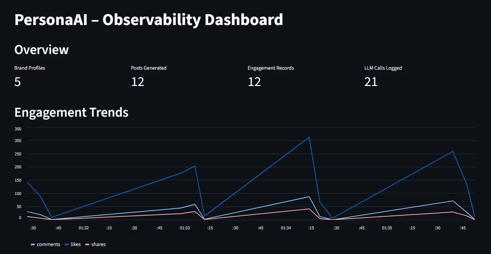
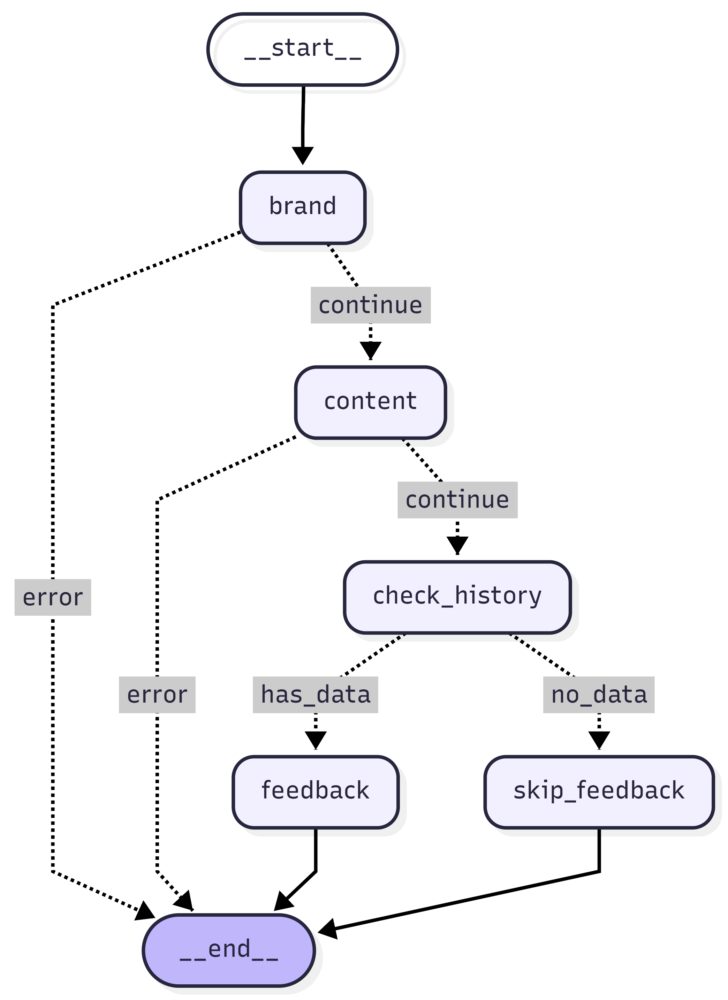

[](https://github.com/BurraRohan/PersonaAI/actions/workflows/tests.yml)


# PersonaAI – Personal Branding Intelligence Agent

A multi-agent system that helps professionals build a consistent LinkedIn personal brand through an end-to-end feedback loop.

---

## What It Does

PersonaAI structures the guesswork out of personal branding. It builds a brand profile, writes posts aligned to that profile, scores a draft before you publish it, records how the post actually performed, and turns that history into concrete strategy advice.

Feedback quality improves as engagement history accumulates — the model is given more real data to reason over. Nothing is trained or fine-tuned.

```
Define Brand → Generate Post → Evaluate → Edit & Approve → Publish → Log Metrics → Get Feedback → Improve
```

---

## Features

- **3 ReAct agents** — each chooses its own tools at runtime, with the tool-call trace returned to the caller
- **Conditional graph routing** — the orchestrator branches on error state and on data availability
- **Engagement prediction** — the model rates a draft on brand alignment, hook strength, readability and call-to-action; the overall score is a weighted composite computed in Python, not taken from the model
- **Human-in-the-loop review** — generated posts start `pending`; a person approves or rejects each one after seeing its score, and nothing enters the engagement pipeline unapproved
- **Edit before approving** — a reviewer can fix a pending post's text and hashtags, then re-score it; the AI's original text is kept on record
- **Post history with full view** — the dashboard lists every post with its status; "Read more" opens the whole text with line breaks intact, and shows the AI original for edited posts
- **Profile management** — create, edit and delete profiles. Edits apply to posts generated afterwards; deletion removes posts and engagement records with no orphaned rows, while audit logs are kept
- **Feedback loop** — analyses recorded engagement and recommends specific changes, referencing actual post topics and numbers
- **Prompt versioning** — every prompt lives in the database with a version number; rollback to any prior version takes one API call and no redeploy. Five content-voice versions ship, from influencer register to plain technical prose
- **Audit logging** — every LLM call recorded with a trace ID, model, prompt version, latency and status
- **Token cost tracking** — every LLM call, including each step of an agent loop, records its input, cached and output tokens and what it cost. Spend by agent, endpoint and day is visible only to the operator, behind a separate admin key
- **Security hardening** — bearer token auth, rate limiting, bounded inputs, sanitised model output, a strict Content-Security-Policy, and agent tools scoped so prompt text cannot redirect them to another profile
- **Prometheus metrics** — request counts, latency histograms and error rates at `/metrics` (API key required)
- **Streamlit dashboard** — engagement trends, audit log inspection and token spend
- **Docker packaging** — `docker-compose` with a named volume and health checks
- **Continuous integration** — GitHub Actions runs the full test suite on every push



---

## Quick Start

### Prerequisites

- Python 3.10+
- A free Groq API key → [console.groq.com/keys](https://console.groq.com/keys)

### Setup

```bash
cd PersonaAI

python -m venv venv
# source venv/bin/activate     # macOS / Linux
venv\Scripts\activate      # Windows

pip install -r requirements.txt

# cp .env.template .env        # macOS / Linux
copy .env.template .env    # Windows
```

Open `.env` and fill in the three required values: `GROQ_API_KEY`, `API_KEY` and `GROQ_MODEL`. The app refuses to start if any is missing rather than falling back to a default. To see token costs, also set `ADMIN_API_KEY` to a second, different key. Generate a key with:

```bash
python -c "import secrets; print(secrets.token_urlsafe(32))"
```

### Run

```bash
uvicorn main:app --reload
```

|                    |                               |
| ------------------ | ----------------------------- |
| App UI             | http://127.0.0.1:8000         |
| Swagger docs       | http://127.0.0.1:8000/docs    |
| Prometheus metrics | http://127.0.0.1:8000/metrics (API key required — use Swagger's Authorize button) |
| Token cost summary | http://127.0.0.1:8000/costs (admin key required — the `AdminKey` lock in Swagger) |

Schema changes and new prompt versions are applied on startup, so an existing
database never needs to be reset.

The UI asks for your API key once and keeps it in `localStorage`, so it survives tab closes and browser restarts. It is never written into the source. To be asked again, type `resetApiKey()` in the browser console.

### Tests

```bash
pytest -q
```

173 tests, all offline — the Groq boundary is stubbed, so the suite covers this project's logic rather than the model's output. `tests/test_security.py` covers each protection listed under [Security](#security), and `tests/test_costs.py` covers the cost arithmetic and who can see it.

The same suite runs on GitHub Actions on every push to `main` (see
`.github/workflows/tests.yml`). Because nothing hits the network, CI needs only
placeholder values for `API_KEY`, `ADMIN_API_KEY`, `GROQ_API_KEY` and `GROQ_MODEL` — no real
credentials are stored on GitHub.

### Streamlit dashboard

```bash
streamlit run streamlit_dashboard.py
```

### Docker

```bash
docker-compose up --build
```

---

## Agent Execution

`/brand`, `/generate` and `/feedback` each run a ReAct agent built with LangChain's `create_agent`. The agent selects its own tools at runtime; the API does not call them in a fixed order.

Every response carries two fields that make this inspectable:

| Field            | Meaning                                                                                                                                                                                    |
| ---------------- | ------------------------------------------------------------------------------------------------------------------------------------------------------------------------------------------ |
| `execution_mode` | `agent` when the agent ran and persisted its work; `direct` when `AGENT_MODE=0` was set deliberately; `fallback_direct` when the agent failed and the single-call path rescued the request |
| `agent_trace`    | Ordered list of the tool calls the model chose, and what each returned                                                                                                                     |

A trace from `POST /brand`:

```json
"execution_mode": "agent",
"agent_trace": [
  { "step": 1, "action": "tool_call",   "tool": "check_existing_profile",  "args": {} },
  { "step": 2, "action": "tool_result", "tool": "check_existing_profile",  "result": "{\"exists\": false}" },
  { "step": 3, "action": "tool_call",   "tool": "generate_brand_strategy", "args": {} },
  { "step": 4, "action": "tool_result", "tool": "generate_brand_strategy", "result": "{\"tone\": \"Professional yet approachable...\"}" },
  { "step": 5, "action": "tool_call",   "tool": "save_brand_profile",      "args": {} },
  { "step": 6, "action": "tool_result", "tool": "save_brand_profile",      "result": "{\"id\": 6, \"status\": \"saved\"}" }
]
```

The model was not told to call those tools in that order. It checked for an
existing profile first, saw none, generated a strategy, then persisted it —
choosing each step from the tool descriptions alone. Tool results longer than
400 characters are truncated in the trace to keep responses readable.

The tools take no arguments. Each agent's tools are built for one request, with
the person's details, profile id and topic attached in code from the validated
input. The model decides which tool to call and when, but never retypes what
gets saved, so a slipped character in a name cannot reach the database.

### Tools available to each agent

| Agent    | Tools                                                                                |
| -------- | ------------------------------------------------------------------------------------ |
| Brand    | `check_existing_profile`, `generate_brand_strategy`, `save_brand_profile`            |
| Content  | `fetch_brand_profile`, `list_recent_topics`, `create_and_save_post`                  |
| Feedback | `fetch_engagement_history`, `compute_engagement_stats`, `generate_strategy_feedback` |

`compute_engagement_stats` does its arithmetic in Python rather than asking the model to average numbers, so the statistics the agent reasons over are exact.

### Agent mode

Running the agent loop costs roughly 3-6 Groq calls per request, because the
model has to see each tool's output before choosing the next one. On Groq's
free tier that adds up quickly while developing.

`AGENT_MODE` in `.env` controls this:

| Value         | Behaviour                                         | `execution_mode` in the response |
| ------------- | ------------------------------------------------- | -------------------------------- |
| `1` (default) | Runs the ReAct agents; `agent_trace` is populated | `agent`                          |
| `0`           | One direct LLM call; `agent_trace` is empty       | `direct`                         |

Endpoints, request bodies and response fields are identical either way, so the
frontend does not care which mode is active. Restart the server after changing it.

### Why there is a fallback

A rate limit or a malformed tool call would otherwise surface as a 500. When the agent path fails, the endpoint completes through a single deterministic LLM call and reports `execution_mode: "fallback_direct"`, with the failure recorded in the trace.

---

## Human-in-the-Loop Review

A generated post is a draft, not a decision. Every post created through
`/generate` starts with `status: "pending"` and stays out of the pipeline until
a person reviews it.

The review happens in the **Evaluate** tab, where the score and the decision sit
together: you see the predicted engagement, the brand-alignment breakdown and the
improvement tips, then approve, reject, or edit on the same screen.

**Edit before deciding** opens the post for correction — an invented figure, a
claim you would not make, a hashtag you would not use. Saving re-runs the
evaluation on the edited text, so the decision is made on what will actually be
published. The model's original text is kept in `original_content` and shown
under "Read more", so the record shows what the AI wrote and what changed.

| State      | Meaning                                                             |
| ---------- | ------------------------------------------------------------------- |
| `pending`  | Generated but not yet reviewed. Cannot receive engagement.          |
| `approved` | A person accepted it. Counts toward feedback and dashboard stats.   |
| `rejected` | A person declined it. Kept in the database, excluded from analysis. |

Four things follow from the status:

- `POST /engagement` returns **409** for a post that is not approved — engagement
  only makes sense for something that was actually published.
- The Feedback agent analyses approved posts only, so unreviewed drafts and
  rejected ones do not shape strategy advice.
- Only `pending` posts can be edited. An approved post may already have
  engagement logged against it, and changing its text would make those numbers
  describe a post that no longer exists.
- Rejected posts are **not deleted**. The row stays, with the reviewer's note,
  so there is a record of what the system produced and what a human chose not to
  use — the same reasoning behind the audit log.

`/predict` takes either a `post_id` or free `draft_content`. A saved post can be
approved or rejected; pasted text is scored only, because there is nothing in the
database to act on.

---

## Orchestration Graph

`POST /orchestrate` runs the whole pipeline through a LangGraph `StateGraph` with conditional edges. Routing is decided at runtime, not hardcoded.



`check_history` exists because feedback on a profile with no logged engagement is meaningless. Asking a model for a data-driven analysis of zero data invites it to invent numbers. The graph routes to `skip_feedback` instead and says so; `feedback_available` in the response tells the caller which branch ran.

Render the live diagram:

```python
from agents.orchestrator import render_graph_mermaid
print(render_graph_mermaid())
```

---

## Scoring

The model rates four dimensions, and the overall score is computed from them:

| Dimension         | Weight | What it judges                                    |
| ----------------- | ------ | ------------------------------------------------- |
| `hook_strength`   | 35%    | The first line alone — would it stop a scroll?    |
| `call_to_action`  | 25%    | Does the ending invite a reply, or trail off?     |
| `brand_alignment` | 20%    | How closely themes and tone match the profile     |
| `readability`     | 20%    | Sentence length, paragraph breaks, jargon density |

The composite is computed in Python rather than requested from the model.
Language models judge qualities well and combine them poorly, so the weighting
is arithmetic — the same reason `compute_engagement_stats` calculates averages
instead of asking for them.

The weights are a judgement call, not a fitted model. They are in one place
(`SCORE_WEIGHTS` in `services/llm_service.py`) and easy to change.

---

## Writing Voice

The content prompt ships in five versions, all kept in the database. Voice is a
product decision rather than a code change: `POST /prompts/content/rollback/1`
switches the whole system to a different style in one request, and the choice
persists across restarts.

| Version | Character                                                                     |
| ------- | ----------------------------------------------------------------------------- |
| v1      | LinkedIn-influencer register — emoji lists, high energy, promotional phrasing |
| v2      | Conversational, minimal constraints                                           |
| v3      | Strictly factual, plain prose                                                 |
| v4      | Varied sentence rhythm and real paragraph structure                           |
| v5      | v4 plus warmth and direct address (default)                                   |

v5 is active by default. It defines what a natural voice means rather than
asking for an "engaging" post and letting the model decide: vary sentence
length sharply, open with the claim rather than a wind-up, have a position, use
paragraph breaks, and place emoji beside the thing they refer to.

It also draws a line around what the model may invent. The agent has the topic
and the brand profile, nothing else, so it may not write timestamps, metrics,
log lines, code, named tools, colleagues, or claimed outcomes. Vivid writing
comes from rhythm and a clear opinion, not from fabricated specifics.

The AI-writing pattern list it avoids — em dashes, negative parallelisms,
forced rule-of-three, promotional vocabulary — is drawn from Wikipedia's
"Signs of AI writing", maintained by WikiProject AI Cleanup.

---

## Prompt Versioning in Practice

Every prompt lives in the database with a version number, and exactly one
version per agent is active at a time. `GET /prompts/{agent_name}` lists the
versions; `POST /prompts/{agent_name}/rollback/{version}` switches between
them, with no redeploy and no restart.

Seeding is checked per `(agent, version)` rather than "is the table empty", so a
new version added in code reaches an existing database on the next start without
wiping it. Existing templates are never overwritten, which means a prompt change
should be added as a new version rather than an edit to an old one.

---

## Token Usage & Cost

Each LLM call stores its token counts and cost in the audit log:

```
cost = uncached input × input price + cached input × input price × 0.5 + output × output price
```

| | |
| --- | --- |
| Prices | $0.15 input / $0.60 output per million tokens (Groq, `openai/gpt-oss-120b`). Set in `.env`. |
| Agent loops | Logged as `<agent>_agent` (e.g. `brand_agent`), separate from the calls its tools make (`brand`) |
| Per action | All calls in one request share a `request_id` and endpoint, so an action's cost is the sum of its rows |
| Access | `ADMIN_API_KEY` only. The app's `API_KEY` gets a 403, and the routes are off when no admin key is set. |

| Where | Shows |
| --- | --- |
| `GET /costs?days=30` | Totals, plus cost by agent, by endpoint (average per request) and by day |
| `GET /audit-logs` | Tokens, cost, request id and endpoint for each call |
| Streamlit dashboard | Total spend, cost per action, agent-loop share, cost by agent and day, most expensive actions |

Cost is saved when the call is made, so a later price change does not alter past
figures. Groq's [console](https://console.groq.com) usage page is the billing record.

---

## API Endpoints

Every endpoint except `/health` requires an `Authorization: Bearer <your-api-key>` header. The two operator routes, `/costs` and `/audit-logs`, take `ADMIN_API_KEY` instead.

| Method | Endpoint                                   | Description                                                | Rate limit |
| ------ | ------------------------------------------ | ---------------------------------------------------------- | ---------- |
| POST   | `/brand`                                   | Create a brand profile (brand agent)                       | 10/min     |
| PATCH  | `/brand/{user_id}`                         | Update any profile field; only fields sent are changed     | 10/min     |
| DELETE | `/brand/{user_id}`                         | Delete a profile with its posts and engagement records     | 10/min     |
| POST   | `/generate`                                | Generate a LinkedIn post (content agent)                   | 10/min     |
| POST   | `/predict`                                 | Score a saved post (by `post_id`) or pasted draft text     | 10/min     |
| GET    | `/posts/pending/{user_id}`                 | Posts awaiting a human decision                            | —          |
| GET    | `/posts/{post_id}`                         | One post in full, with status, edit history and engagement | —          |
| PATCH  | `/posts/{post_id}`                         | Edit a pending post's text or hashtags                     | 30/min     |
| POST   | `/posts/{post_id}/review`                  | Approve or reject a generated post                         | 30/min     |
| POST   | `/engagement`                              | Log likes, comments and shares for an **approved** post    | 30/min     |
| POST   | `/feedback`                                | Strategy feedback from engagement history (feedback agent) | 10/min     |
| POST   | `/orchestrate`                             | Run the full graph: brand → content → feedback             | 5/min      |
| GET    | `/dashboard/{user_id}`                     | Brand info, totals, averages, best topic, post list        | —          |
| GET    | `/history/{user_id}`                       | All posts and engagement for a profile                     | —          |
| GET    | `/prompts/{agent_name}`                    | List prompt versions for an agent                          | —          |
| POST   | `/prompts/{agent_name}/rollback/{version}` | Activate a specific prompt version                         | —          |
| GET    | `/audit-logs`                              | Recent LLM calls with tokens and cost, filterable by `agent_name` (max 500). Admin key | —          |
| GET    | `/costs`                                   | Token and cost summary over the last `days` (1–365). Admin key | —          |
| GET    | `/metrics`                                 | Prometheus metrics                                         | —          |
| GET    | `/health`                                  | Health check (public)                                      | —          |

Valid `agent_name` values: `brand`, `content`, `feedback`, `predictor`.

---

## Security

| Area | Protection |
| --- | --- |
| Authentication | Bearer token on every data route, compared in constant time. No default key: the app will not start without one. |
| Model output | Scores are coerced to integers and ranges to digits before leaving the server, and the UI escapes everything it renders. |
| Prompt injection | Agent tools are built per request with the person's details, profile id and topic fixed in code, so text in a prompt cannot redirect them to another profile's data or change what gets saved. |
| Input | Every field has a length limit, numbers are bounded, IDs are range-checked, and request bodies are capped at 64 KB. |
| Browser | Strict Content-Security-Policy (scripts from this origin only, no inline code), plus `nosniff`, `DENY` framing and `no-referrer`. |
| Errors | Provider and internal error text goes to the server log; clients get a generic message with a trace id. |
| Observability | `/metrics` requires the API key unless `METRICS_PUBLIC=1`. |
| Operator data | Token usage and cost are served only on routes that take a separate `ADMIN_API_KEY`. The user's key is refused, and the routes are off when no admin key is set. |
| Container | Runs as an unprivileged user, not root. |
| Dependencies | Pinned to patched versions and checked with `pip-audit`. |

---

## Architecture

```
PersonaAI/
├── .github/workflows/
│   └── tests.yml            # CI: runs pytest on every push
├── main.py                  # FastAPI entry point, routes, prompt seeding
├── agents/
│   ├── brand_agent.py       # ReAct agent: brand profile creation
│   ├── content_agent.py     # ReAct agent: LinkedIn post generation
│   ├── feedback_agent.py    # ReAct agent: engagement analysis
│   └── orchestrator.py      # LangGraph StateGraph with conditional edges
├── services/
│   └── llm_service.py       # Groq wrapper: retries, JSON parsing, output sanitising
├── database/
│   ├── models.py            # SQLAlchemy ORM models
│   └── db.py                # Engine, session, additive schema migration
├── schemas/
│   └── schemas.py           # Pydantic request/response models with input limits
├── utils/
│   ├── agent_runtime.py     # Agent execution + tool-call trace capture
│   ├── config.py            # AGENT_MODE and GROQ_MODEL, read from .env
│   ├── auth.py              # API key and admin key authentication
│   ├── costs.py             # Token usage and cost per call
│   ├── request_context.py   # Request id and endpoint for cost attribution
│   ├── security.py          # Security headers and request size limit
│   ├── rate_limiter.py      # Request rate limiting
│   └── observability.py     # Prometheus metrics + structured logging
├── static/                  # Frontend UI (6-tab dashboard)
├── tests/                   # pytest suite (173 tests, no network required)
├── streamlit_dashboard.py   # Observability and cost dashboard
├── Dockerfile
├── docker-compose.yml
├── requirements.txt
└── .env.template
```

---

## Environment Variables

| Variable            | Description                                                           | Required | Default                                       |
| ------------------- | --------------------------------------------------------------------- | -------- | --------------------------------------------- |
| `GROQ_API_KEY`      | Groq API key — [console.groq.com/keys](https://console.groq.com/keys) | Yes      | — (app will not start)                        |
| `API_KEY`           | Bearer token protecting the API                                       | Yes      | — (app will not start)                        |
| `GROQ_MODEL`        | Groq model used by all agents and LLM calls                           | Yes      | — (app will not start)                        |
| `AGENT_MODE`        | `1` runs the ReAct agents, `0` uses one direct LLM call               | No       | `1`                                           |
| `DATABASE_URL`      | SQLAlchemy connection string                                          | No       | `sqlite:///./personaai.db`                    |
| `PERSONAAI_DB_PATH` | SQLite path used by the Streamlit dashboard                           | No       | `personaai.db`                                |
| `ALLOWED_ORIGINS`   | Comma-separated CORS origins                                          | No       | `http://localhost:8000,http://127.0.0.1:8000` |
| `METRICS_PUBLIC`    | `1` makes `/metrics` public; only for private networks                | No       | `0`                                           |
| `ADMIN_API_KEY`     | Separate key for `/costs` and `/audit-logs`; must differ from `API_KEY` | No     | — (operator routes off)                       |
| `LLM_INPUT_PRICE_PER_MILLION`  | Input price in USD per million tokens                      | No       | `0.15`                                        |
| `LLM_OUTPUT_PRICE_PER_MILLION` | Output price in USD per million tokens                     | No       | `0.60`                                        |

The model name lives only in `.env` — never in the source — so a provider
deprecation is a one-line config change. It is deliberately not auto-selected:
tool-calling reliability differs between models, and the audit log records the
model per call, so past runs stay reproducible. Check
[Groq's deprecation page](https://console.groq.com/docs/deprecations) for current models.

---

## Tech Stack

**Backend** — Python, FastAPI, SQLAlchemy, SQLite, Pydantic v2

**Agents** — LangChain (tools + `create_agent`), LangGraph `StateGraph`, Groq

**Observability** — Prometheus, Streamlit, database-backed audit logs, per-call token and cost accounting

**Security** — Bearer token auth, SlowAPI rate limiting, Content-Security-Policy, input bounds, output sanitising, pip-audit

**Packaging & CI** — Docker, docker-compose, Gunicorn with Uvicorn workers, GitHub Actions

---

## Known Limitations

Stated plainly, because they shape how the results should be read:

- **Engagement prediction is unvalidated.** The scores come from the model's judgement, not a regression fitted to real LinkedIn data. Treat them as a structured second opinion, not a forecast. Validating them would require a labelled dataset of posts and their actual performance.
- **No publishing integration.** Approved posts are stored, not published; you copy them to LinkedIn yourself. There is no LinkedIn API connection, which is also why approval is a manual step rather than a publish trigger.
- **Engagement figures are entered by hand.** Nothing verifies that the numbers logged via `/engagement` match reality.
- **Single-tenant auth.** One shared API key protects the whole instance. There are no user accounts, and any holder of the key can read every profile.
- **The API key lives in the browser.** The UI keeps it in `localStorage` for convenience. Output escaping and the Content-Security-Policy guard it against script injection, but anyone with access to the browser profile can read it.
- **No HTTPS out of the box.** Serve it behind a TLS-terminating proxy before exposing it beyond your own machine.
- **SQLite concurrency.** Fine for a single instance; a multi-worker deployment under write load should move to PostgreSQL.
- **Agent reliability varies.** The model occasionally skips a tool call in a three-step chain. The fallback path covers this, but `execution_mode` is worth checking when a run looks unusual.
- **Cost is computed, not billed.** Figures come from the token counts Groq returns, priced at the rates in `.env`. Groq's console remains the record of what was actually charged; if Groq changes its prices, update `.env` to match. An agent run that fails partway records the failure but not the tokens spent before it.
- **Not deployed.** The project is containerized and runs locally or via `docker-compose`, but there is no hosted instance.

---
